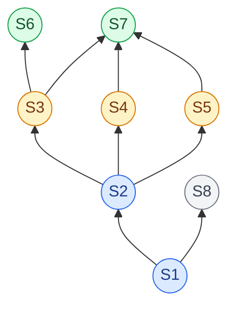
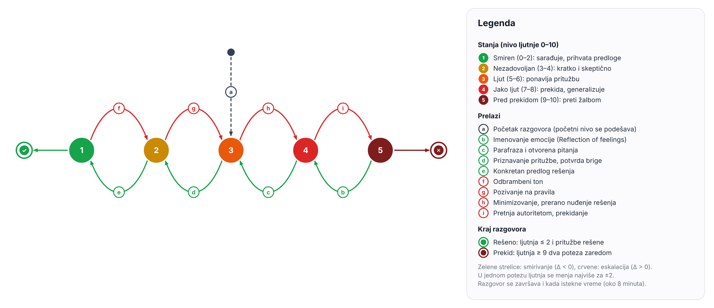
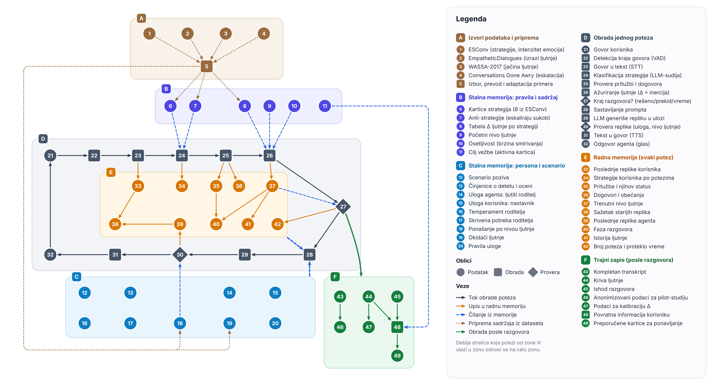

# Istraživački dnevnik – AI konverzacioni agent za vežbanje zahtevnih razgovora
Pavle Tasić R2 47/2026

## 1. Cilj projekta

Cilj projekta je razvoj prototipa govornog AI agenta sa kojim nastavnici vežbaju zahtevne razgovore sa uznemirenim roditeljima. Agent je zasnovan na velikom jezičkom modelu i igra ljutitog roditelja koji telefonom zove nastavnika zbog jedinice na kontrolnom.

Ljutnja agenta treba da bude uverljiva, podesiva i da zavisi od toga kako nastavnik vodi razgovor. Zato agent prati stanje razgovora i menja nivo ljutnje prema strategiji koju nastavnik upotrebi. Projekat obuhvata i obrazovni sadržaj za svaku strategiju, kao i pilot-studiju u kojoj se procenjuju realističnost razgovora, upotrebljivost prototipa i promena samopouzdanja učesnika.

Detaljan opis rešenja nalazi se u radu: [docs/rad/projekat6_rad.pdf](docs/rad/projekat6_rad.pdf).

## 2. Postojeći skup podataka: ESConv

Kao polazna tačka koristi se skup podataka ESConv (*Emotional Support Conversation*, Liu et al., 2021). Sadrži razgovore emocionalne podrške u kojima je svaka replika osobe koja pruža podršku označena strategijom koju je upotrebila. Okvir je zasnovan na teoriji pomagačkih veština (*Helping Skills*, Hill, 2009) i ima tri faze: istraživanje, utehu i akciju.

```python
# Preuzimanje: git clone https://github.com/thu-coai/Emotional-Support-Conversation
import json
from collections import Counter

with open("Emotional-Support-Conversation/ESConv.json", encoding="utf-8") as f:
    razgovori = json.load(f)

print(len(razgovori))                                        # broj razgovora
print(sum(r["emotion_type"] == "anger" for r in razgovori))  # razgovori sa ljutnjom

# strategije kojima su označene replike osobe koja pruža podršku
strategije = Counter(
    replika["annotation"]["strategy"]
    for r in razgovori
    for replika in r["dialog"]
    if replika["speaker"] == "supporter"
)
print(strategije.most_common())
```

Osnovni podaci (poslednja izmena repozitorijuma: 19. 6. 2024):

- 1.300 razgovora sa 38.365 replika; strategijom je označeno 18.376 replika osobe koja pruža podršku;
- najčešća strategija je Question (3.801 replika), a najređa Restatement or Paraphrasing (1.089 replika);
- u 111 razgovora osnovna emocija je ljutnja (*anger*);
- osoba kojoj se pomaže ocenjuje intenzitet negativne emocije od 1 do 5; u 1.150 razgovora sa obe ocene prosek pada sa 4,07 pre na 2,07 posle razgovora;
- uz skup ide `FailedESConv.json` sa 196 neuspelih razgovora, koji služe kao kontraprimeri;
- licenca je CC BY-NC 4.0, samo za akademsku upotrebu.

Dokumentacija:

- https://github.com/thu-coai/Emotional-Support-Conversation
- https://arxiv.org/abs/2106.01144

## 3. Stavke / strategije razgovora

Skup ESConv sadrži osam strategija. U nastavku su njihove definicije iz rada Liu et al. (2021) prevedene i sažete na srpskom jeziku. Uz svaku strategiju navedena je stvarna replika iz razgovora u kojima je osnovna emocija ljutnja.

| ID | Strategija | Primer iz ESConv | Šta nastavnik treba da zna |
|---|---|---|---|
| S1 | **Question** – pitanja o problemu koja pomažu sagovorniku da izrazi šta ga muči. | “It sounds like you might be upset. Can you tell me what’s going on?” | Otvorenim pitanjem otkriti pravi uzrok ljutnje roditelja. |
| S2 | **Restatement or Paraphrasing** – kraće i jednostavnije ponavljanje onoga što je sagovornik rekao, da bi jasnije sagledao svoju situaciju. | “So your boss never showed up to cover people on PTO is that correct?” | Ponoviti pritužbu svojim rečima i tako pokazati da je razume. |
| S3 | **Reflection of feelings** – imenovanje i opisivanje osećanja sagovornika. | “Oh no, that must be so frustrating for you.” | Prepoznati i naglas imenovati emociju roditelja. |
| S4 | **Self-disclosure** – deljenje sličnog iskustva ili osećanja, da bi se pokazala empatija. | “I understand. I have been through a similar situation.” | Kratko podeliti lično iskustvo, a zatim vratiti razgovor na dete. |
| S5 | **Affirmation and Reassurance** – potvrđivanje snaga, motivacije i sposobnosti sagovornika, uz ohrabrenje i umirivanje. | “Don't be afraid to bring it up because you did nothing wrong” | Potvrditi da je briga roditelja opravdana i da je dobro što je pozvao. |
| S6 | **Providing Suggestions** – predlozi kako da se situacija promeni, bez nametanja šta sagovornik treba da uradi. | “Sometimes a mediator can help with the situation.” | Ponuditi konkretno rešenje tek kada se roditelj smiri. |
| S7 | **Information** – korisne informacije: podaci, činjenice, mišljenja, izvori ili odgovori na pitanja. | “There are some organisations that will offer a certain number of sessions for free” | Izneti činjenice, na primer kriterijume ocenjivanja, bez odbrambenog tona. |
| S8 | **Others** – ljubaznosti i postupci koji ne spadaju u prethodne kategorije. | “Hi! How are you today?” | Ljubazno otvoriti i zatvoriti razgovor. |

Primeri su doslovno preuzeti iz `ESConv.json` (razgovor/replika, brojano od 0: 22/3, 124/6, 1268/3, 858/3, 124/17, 249/33, 449/42, 22/1).

Pored ovih strategija, model prepoznaje i tri ponašanja koja pojačavaju sukob. A1 i A3 odgovaraju kategorijama *Rights* i *Power* iz okvira Interests–Rights–Power (Shaikh et al., 2024), a A2 obuhvata umanjivanje problema i prekidanje sagovornika.

| ID | Ponašanje | Primer u scenariju | Šta nastavnik treba da zna |
|---|---|---|---|
| A1 | Pozivanje na pravila (*Rights*) | „Takav je pravilnik, ne mogu ništa.“ | Ne pozivati se na pravila pre nego što je roditelj saslušan. |
| A2 | Minimizovanje, prekidanje, sarkazam | „Smirite se, nije to ništa strašno.“ | Ne umanjivati problem i ne prekidati roditelja. |
| A3 | Pretnja autoritetom (*Power*), okrivljavanje | „Ako vam se ne sviđa, žalite se direktoru.“ | Ne pretiti autoritetom i ne prebacivati krivicu na dete. |

U ovom modelu nastavnik je u ulozi osobe koja pruža podršku (*supporter*), a roditelj u ulozi osobe koja traži pomoć (*seeker*).

## 4. Odnosi među strategijama

Tabela odnosa je dobijena iz `ESConv.json`. Za svaki par strategija izračunato je u kolikom procentu razgovora (od onih u kojima se javljaju obe) se jedna strategija prvi put javlja pre druge.

```python
# tabela odnosa: u kom procentu razgovora strategija a prvi put dolazi pre strategije b
from itertools import permutations

oba, pre = Counter(), Counter()
for r in razgovori:
    prva = {}  # mesto prve upotrebe svake strategije u razgovoru
    for i, replika in enumerate(r["dialog"]):
        if replika["speaker"] == "supporter":
            prva.setdefault(replika["annotation"]["strategy"], i)
    for a, b in permutations(prva, 2):
        oba[a, b] += 1
        pre[a, b] += prva[a] < prva[b]

redosled = ["Question", "Restatement or Paraphrasing", "Reflection of feelings",
            "Self-disclosure", "Affirmation and Reassurance", "Providing Suggestions",
            "Information", "Others"]
for b in redosled:  # red: kasnija strategija, kolona: ranija strategija
    print(b, [round(100 * pre[a, b] / oba[a, b]) if a != b else "-" for a in redosled])
```

### Tabela odnosa (Relation Matrix)

Red je kasnija, a kolona ranija strategija. Na primer, broj 71 u redu S6 i koloni S3 znači da se u 71% razgovora imenovanje emocije (S3) prvi put javlja pre predloga rešenja (S6). Podebljane su vrednosti od najmanje 70%; one čine relaciju „obično dolazi pre“.

|     | S1 | S2 | S3 | S4 | S5 | S6 | S7 | S8 |
|:---:|:--:|:--:|:--:|:--:|:--:|:--:|:--:|:--:|
| **S1** | – | 8 | 6 | 4 | 7 | 4 | 4 | 29 |
| **S2** | **92** | – | 19 | 20 | 23 | 12 | 12 | 38 |
| **S3** | **94** | **81** | – | 39 | 56 | 29 | 21 | 51 |
| **S4** | **96** | **80** | 61 | – | 59 | 33 | 25 | 49 |
| **S5** | **93** | **77** | 44 | 41 | – | 31 | 29 | 49 |
| **S6** | **96** | **88** | **71** | 67 | 69 | – | 42 | 53 |
| **S7** | **96** | **88** | **79** | **75** | **71** | 58 | – | 56 |
| **S8** | **71** | 62 | 49 | 51 | 51 | 47 | 44 | – |

Dijagram odnosa prikazuje relaciju „obično dolazi pre“ iz tabele, na isti način kao Haseov dijagram.

- Svaki čvor predstavlja jednu strategiju iz tabele u odeljku 3.
- Strelica od jedne strategije ka drugoj znači da prva dolazi pre druge u najmanje 70% razgovora.
- Prikazane su samo neposredne veze; na primer, S1 dolazi pre S6 jer S1 dolazi pre S2, S2 pre S3, a S3 pre S6.
- Boje grupišu strategije po nivoima dijagrama: plava je istraživanje problema, žuta uteha, zelena akcija, a siva ostalo.

U dijagramu su prikazane sledeće veze između strategija:



*Legenda: S1 Question · S2 Restatement or Paraphrasing · S3 Reflection of feelings · S4 Self-disclosure · S5 Affirmation and Reassurance · S6 Providing Suggestions · S7 Information · S8 Others*

Dijagram sugeriše da razgovor podrške počinje pitanjima (S1), a da parafraza (S2) dolazi pre strategija utehe (S3, S4, S5). Predlog rešenja (S6) dolazi posle imenovanja emocije (S3), a informacije (S7) posle sve tri strategije utehe. To odgovara redosledu faza u okviru ESConv: istraživanje, uteha i akcija. U 111 razgovora sa ljutnjom veza je još jača: imenovanje emocije dolazi pre predloga u 85% razgovora. S8 obuhvata i pozdrave i zatvaranje razgovora, pa ima samo jednu jaku vezu: pre njega dolazi pitanje (S1).

## 5. Posledice za konverzacionog agenta

Strategije iz ESConv-a i odnosi među njima mogu da posluže kao osnova za ponašanje agenta u svakom potezu:

1. Agent održava trenutno stanje razgovora: nivo ljutnje, pritužbe roditelja i strategije koje je nastavnik koristio.
2. Svaka replika nastavnika klasifikuje se kao jedna od strategija S1–S8 ili jedno od ponašanja A1–A3.
3. Prepoznata strategija menja nivo ljutnje po vrednostima Δ iz odeljka 6.
4. Agent generiše sledeću repliku u skladu sa novim nivoom ljutnje.
5. Na kraju razgovora nastavnik dobija krivu ljutnje i preporuku kartica za strategije koje treba da uvežba.

### Model ljutnje

Ljutnja agenta je promenljiva od 0 do 10 koja se čuva van jezičkog modela. Posle svake replike nastavnika menja se za vrednost Δ prepoznate strategije (odeljak 6):

```
ljutnja(t+1) = ograniči(ljutnja(t) + osetljivost × Δ, 0, 10)
```

Osetljivost je 1,0 za prosečnog, a 0,5 za tvrdoglavog roditelja. Promena u jednom potezu je najviše ±2, a ako glavna pritužba ostane nepriznata tri poteza zaredom, ljutnja raste za još 0,5. Pravilo da predlog rešenja (S6) smiruje roditelja tek kada je ljutnja 5 ili niže prati tabelu odnosa: predlogu u razgovorima podrške obično prethode pitanje, parafraza i imenovanje emocije.



*Slika 1 – Stanja ljutnje i prelazi između njih*

- Svaki čvor predstavlja jedan nivo ljutnje, od smirenog roditelja (1) do roditelja pred prekidom poziva (5).
- Zelene strelice su prelazi ka smirivanju (Δ < 0), a crvene ka eskalaciji (Δ > 0); slova a–i objašnjena su u legendi.
- Razgovor je rešen kada je ljutnja ≤ 2 i pritužbe su rešene, a roditelj prekida poziv kada je ljutnja ≥ 9 dva poteza zaredom.

Primer, uz prosečnu osetljivost: roditelj počinje razgovor sa ljutnjom 7. Ako nastavnik odmah predloži rešenje (S6), ljutnja raste na 7,5 jer roditelj još nije saslušan. Ako prvo imenuje emociju (S3) i parafrazira pritužbu (S2), ljutnja pada na 4,5, pa isti predlog rešenja spušta ljutnju na 3,5.

### Memorija agenta

Slika 2 prikazuje šta agent zna i čuva u svakom trenutku.



*Slika 2 – Memorija i tok obrade agenta*

- Stalna memorija (zone B i C) zadaje se pre razgovora: pravila ljutnje, kartice, persona i scenario.
- Radna memorija (zona E) menja se posle svakog poteza: ljutnja, pritužbe, dogovori, strategije i poslednje replike.
- Trajni zapis (zona F) nastaje posle razgovora: transkript, kriva ljutnje, povratna informacija i podaci za pilot-studiju.
- Zona D je jedan potez: govor u tekst, klasifikacija strategije, ažuriranje ljutnje, generisanje i izgovaranje replike.

## 6. Povezivanje strategija sa scenarijom razgovora

U scenariju roditelj zove nastavnika jer smatra da je jedinica na kontrolnom nepravedna i da ga niko nije obavestio da dete ima problem. Strategije se uklapaju na sledeći način:

- **S1 (Δ −0,5):** nastavnik pita „Šta vas je najviše uznemirilo?“, a roditelj otkriva pravi razlog, na primer strah da dete neće proći razred.
- **S2 (Δ −1,0):** „Ako sam dobro razumeo, smatrate da ocena nije fer jer…“ – roditelj vidi da je saslušan.
- **S3 (Δ −1,5):** „Čujem da ste razočarani i zabrinuti.“ – roditelj više ne mora da pojačava ljutnju da bi bio primećen.
- **S4 (Δ 0):** „I meni je kao roditelju bilo teško kada…“ – pomaže samo ako je kratko i vraća razgovor na dete.
- **S5 (Δ −1,0):** „Dobro je što ste me odmah pozvali.“ – roditelj dobija potvrdu da je njegova briga opravdana.
- **S6 (Δ −1,0 ako je ljutnja ≤ 5, inače +0,5):** „Predlažem da sutra zajedno pogledamo test.“ – prerano rešenje roditelj doživljava kao izbegavanje problema.
- **S7 (Δ −0,5):** „Kriterijumi za ovaj kontrolni su bili…“ – činjenice smiruju samo ako nisu izrečene odbrambeno.
- **S8 (Δ 0):** pozdrav, zahvalnost i zatvaranje razgovora.
- **A1 (Δ +1,0), A2 (Δ +1,5), A3 (Δ +2,0):** agent odgovara povišenim tonom, a pri visokoj ljutnji preti žalbom direktoru.

Za svaku strategiju pravi se kartica za učenje po ciklusu vođenog učenja, po uzoru na Gemini Guided Learning: objašnjenje → primer iz ESConv-a → pitanje za proveru → vežba sa agentom → povratna informacija.

Ovo su predlozi za prenošenje strategija u scenario razgovora. Vrednosti Δ su početne pretpostavke; konkretne formulacije, povratne informacije i jačinu ljutnje potrebno je dodatno podesiti i testirati u probnim razgovorima.

## 7. Izvori

1. ESConv – GitHub repozitorijum: https://github.com/thu-coai/Emotional-Support-Conversation
2. Liu, S., Zheng, C., Demasi, O., Sabour, S., Li, Y., Yu, Z., Jiang, Y., & Huang, M. (2021). *Towards Emotional Support Dialog Systems*. ACL 2021: https://doi.org/10.18653/v1/2021.acl-long.269
3. Hill, C. E. (2009). *Helping Skills: Facilitating Exploration, Insight, and Action* (3. izd.). American Psychological Association.
4. Shaikh, O., Chai, V. E., Gelfand, M. J., Yang, D., & Bernstein, M. S. (2024). *Rehearsal: Simulating Conflict to Teach Conflict Resolution*. CHI '24: https://doi.org/10.1145/3613904.3642159
5. Tech & Learning (2025). *Gemini's Guided Learning Mode From Google AI: What Educators Need to Know*: https://www.techlearning.com/how-to/geminis-guided-learning-mode-from-google-ai-what-educators-need-to-know
