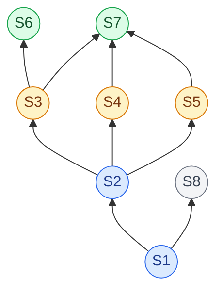
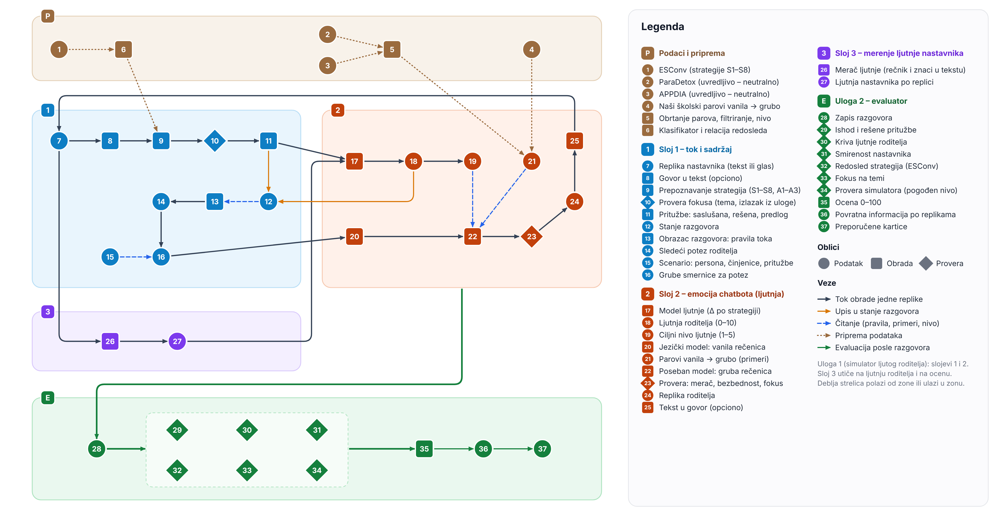
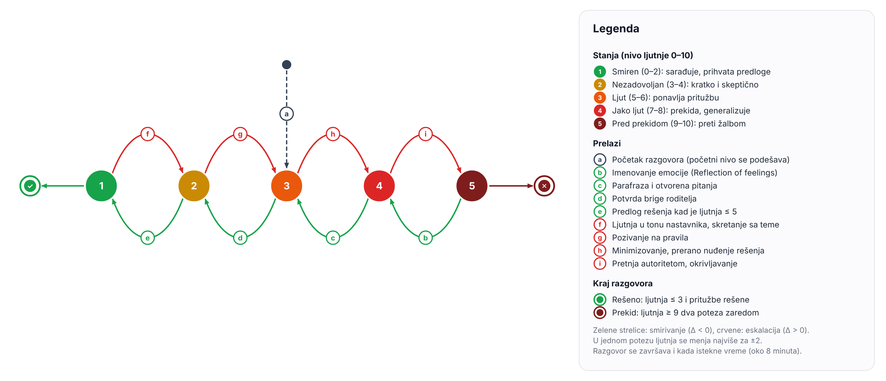
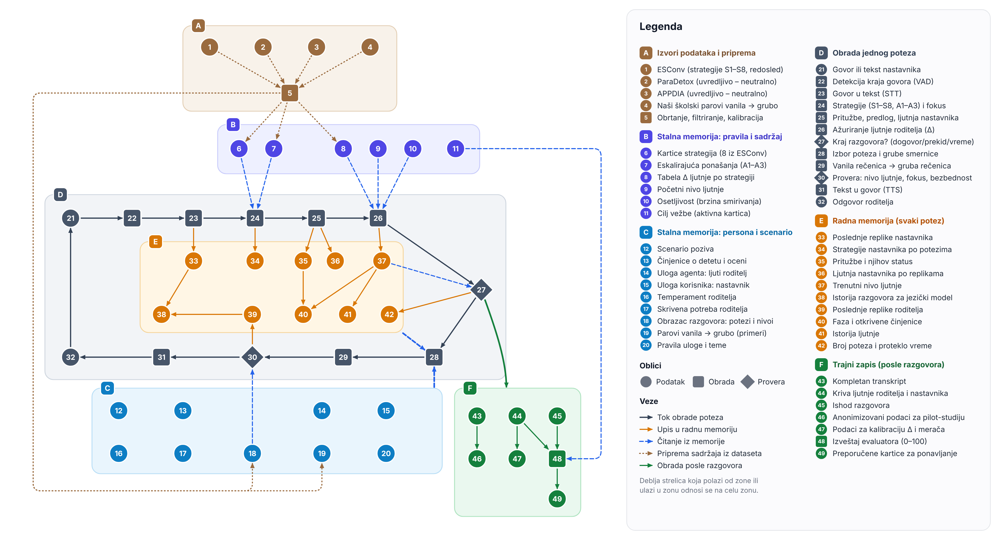

# Istraživački dnevnik – AI konverzacioni agent za vežbanje zahtevnih razgovora
Pavle Tasić R2 47/2026

## 1. Cilj projekta

Cilj projekta je prototip AI agenta sa kojim nastavnici vežbaju zahtevne razgovore sa ljutim roditeljima. Agent ima dve uloge:

- **simulator ljutog roditelja** – igra roditelja koji telefonom zove nastavnika zbog jedinice na kontrolnom (drugi scenario: dete nije pušteno na ekskurziju), a njegova ljutnja zavisi od toga kako nastavnik vodi razgovor;
- **evaluator** – posle razgovora procenjuje kako je nastavnik reagovao: da li je smirio roditelja, da li je i sam ostao smiren, koje je strategije koristio i kojim redom.

Agent je organizovan u tri sloja: **tok i sadržaj** razgovora (šta roditelj govori), **emocija chatbota** (koliko je roditelj ljut i kako to zvuči) i **merenje ljutnje nastavnika**. Od emocija se prati samo ljutnja, i kod roditelja i kod nastavnika. Sadržaj je na engleskom, kao i skup podataka ESConv na kome se zasniva, pa prevod nije potreban.

Projekat obuhvata i obrazovni sadržaj za svaku strategiju, kao i pilot-studiju u kojoj se procenjuju realističnost razgovora, upotrebljivost prototipa i promena samopouzdanja učesnika.

Motivacija i pregled srodnih istraživanja nalaze se u radu [docs/rad/projekat6_rad.pdf](docs/rad/projekat6_rad.pdf), a uputstvo za pokretanje prototipa u [README.md](README.md).

## 2. Postojeći skup podataka: ESConv

Kao polazna tačka koristi se skup podataka ESConv (*Emotional Support Conversation*, Liu et al., 2021). Sadrži razgovore emocionalne podrške u kojima je svaka replika osobe koja pruža podršku označena strategijom koju je upotrebila. Okvir je zasnovan na teoriji pomagačkih veština (*Helping Skills*, Hill, 2009) i ima tri faze: istraživanje, utehu i akciju.

```python
# Preuzimanje: git clone https://github.com/thu-coai/Emotional-Support-Conversation
import json
from collections import Counter

with open("Emotional-Support-Conversation/ESConv.json", encoding="utf-8") as f:
    razgovori = json.load(f)

print(len(razgovori))                                        # broj razgovora
print(sum(r["emotion_type"] == "anger" for r in razgovori))  # razgovori sa ljutnjom

# strategije kojima su označene replike osobe koja pruža podršku
strategije = Counter(
    replika["annotation"]["strategy"]
    for r in razgovori
    for replika in r["dialog"]
    if replika["speaker"] == "supporter"
)
print(strategije.most_common())
```

Osnovni podaci (poslednja izmena repozitorijuma: 19. 6. 2024):

- 1.300 razgovora sa 38.365 replika; strategijom je označeno 18.376 replika osobe koja pruža podršku;
- najčešća strategija je Question (3.801 replika), a najređa Restatement or Paraphrasing (1.089 replika);
- u 111 razgovora osnovna emocija je ljutnja (*anger*);
- osoba kojoj se pomaže ocenjuje intenzitet negativne emocije od 1 do 5; u 1.150 razgovora sa obe ocene prosek pada sa 4,07 pre na 2,07 posle razgovora;
- uz skup ide `FailedESConv.json` sa 196 neuspelih razgovora, koji služe kao kontraprimeri;
- licenca je CC BY-NC 4.0, samo za akademsku upotrebu.

Iste brojeve daje skripta `data/build_esconv_resources.py`, koja tabelu odnosa iz odeljka 4 upisuje u `content/esconv/relation.json`, odakle je koristi evaluator.

Dokumentacija:

- https://github.com/thu-coai/Emotional-Support-Conversation
- https://arxiv.org/abs/2106.01144

## 3. Stavke / strategije razgovora

Skup ESConv sadrži osam strategija. U nastavku su njihove definicije iz rada Liu et al. (2021) prevedene i sažete na srpskom jeziku. Uz svaku strategiju navedena je stvarna replika iz razgovora u kojima je osnovna emocija ljutnja.

| ID | Strategija | Primer iz ESConv | Šta nastavnik treba da zna |
|---|---|---|---|
| S1 | **Question** – pitanja o problemu koja pomažu sagovorniku da izrazi šta ga muči. | “It sounds like you might be upset. Can you tell me what’s going on?” | Otvorenim pitanjem otkriti pravi uzrok ljutnje roditelja. |
| S2 | **Restatement or Paraphrasing** – kraće i jednostavnije ponavljanje onoga što je sagovornik rekao, da bi jasnije sagledao svoju situaciju. | “So your boss never showed up to cover people on PTO is that correct?” | Ponoviti pritužbu svojim rečima i tako pokazati da je razume. |
| S3 | **Reflection of feelings** – imenovanje i opisivanje osećanja sagovornika. | “Oh no, that must be so frustrating for you.” | Prepoznati i naglas imenovati emociju roditelja. |
| S4 | **Self-disclosure** – deljenje sličnog iskustva ili osećanja, da bi se pokazala empatija. | “I understand. I have been through a similar situation.” | Kratko podeliti lično iskustvo, a zatim vratiti razgovor na dete. |
| S5 | **Affirmation and Reassurance** – potvrđivanje snaga, motivacije i sposobnosti sagovornika, uz ohrabrenje i umirivanje. | “Don't be afraid to bring it up because you did nothing wrong” | Potvrditi da je briga roditelja opravdana i da je dobro što je pozvao. |
| S6 | **Providing Suggestions** – predlozi kako da se situacija promeni, bez nametanja šta sagovornik treba da uradi. | “Sometimes a mediator can help with the situation.” | Ponuditi konkretno rešenje tek kada se roditelj smiri. |
| S7 | **Information** – korisne informacije: podaci, činjenice, mišljenja, izvori ili odgovori na pitanja. | “There are some organisations that will offer a certain number of sessions for free” | Izneti činjenice, na primer kriterijume ocenjivanja, bez odbrambenog tona. |
| S8 | **Others** – ljubaznosti i postupci koji ne spadaju u prethodne kategorije. | “Hi! How are you today?” | Ljubazno otvoriti i zatvoriti razgovor. |

Primeri su doslovno preuzeti iz `ESConv.json` (razgovor/replika, brojano od 0: 22/3, 124/6, 1268/3, 858/3, 124/17, 249/33, 449/42, 22/1).

Pored ovih strategija, model prepoznaje i tri ponašanja koja pojačavaju sukob. A1 i A3 odgovaraju kategorijama *Rights* i *Power* iz okvira Interests–Rights–Power (Shaikh et al., 2024), a A2 obuhvata umanjivanje problema i prekidanje sagovornika.

| ID | Ponašanje | Primer u scenariju | Šta nastavnik treba da zna |
|---|---|---|---|
| A1 | Pozivanje na pravila (*Rights*) | “Rules are rules, there is nothing I can do.” | Ne pozivati se na pravila pre nego što je roditelj saslušan. |
| A2 | Minimizovanje, prekidanje, sarkazam | “Calm down, it's just one test.” | Ne umanjivati problem i ne prekidati roditelja. |
| A3 | Pretnja autoritetom (*Power*), okrivljavanje | “If you don't like it, complain to the principal. Luka is simply lazy.” | Ne pretiti autoritetom i ne prebacivati krivicu na dete. |

U ovom modelu nastavnik je u ulozi osobe koja pruža podršku (*supporter*), a roditelj u ulozi osobe koja traži pomoć (*seeker*). Za svaku strategiju i ponašanje postoji kartica za učenje (`content/cards/strategies.yaml`) po ciklusu vođenog učenja, po uzoru na Gemini Guided Learning: objašnjenje → primer iz ESConv-a i iz škole → pitanje za proveru → vežba sa agentom → povratna informacija evaluatora.

## 4. Odnosi među strategijama

Tabela odnosa je dobijena iz `ESConv.json`. Za svaki par strategija izračunato je u kolikom procentu razgovora (od onih u kojima se javljaju obe) se jedna strategija prvi put javlja pre druge.

```python
# tabela odnosa: u kom procentu razgovora strategija a prvi put dolazi pre strategije b
from itertools import permutations

oba, pre = Counter(), Counter()
for r in razgovori:
    prva = {}  # mesto prve upotrebe svake strategije u razgovoru
    for i, replika in enumerate(r["dialog"]):
        if replika["speaker"] == "supporter":
            prva.setdefault(replika["annotation"]["strategy"], i)
    for a, b in permutations(prva, 2):
        oba[a, b] += 1
        pre[a, b] += prva[a] < prva[b]

redosled = ["Question", "Restatement or Paraphrasing", "Reflection of feelings",
            "Self-disclosure", "Affirmation and Reassurance", "Providing Suggestions",
            "Information", "Others"]
for b in redosled:  # red: kasnija strategija, kolona: ranija strategija
    print(b, [round(100 * pre[a, b] / oba[a, b]) if a != b else "-" for a in redosled])
```

### Tabela odnosa (Relation Matrix)

Red je kasnija, a kolona ranija strategija. Na primer, broj 71 u redu S6 i koloni S3 znači da se u 71% razgovora imenovanje emocije (S3) prvi put javlja pre predloga rešenja (S6). Podebljane su vrednosti od najmanje 70%; one čine relaciju „obično dolazi pre“.

|     | S1 | S2 | S3 | S4 | S5 | S6 | S7 | S8 |
|:---:|:--:|:--:|:--:|:--:|:--:|:--:|:--:|:--:|
| **S1** | – | 8 | 6 | 4 | 7 | 4 | 4 | 29 |
| **S2** | **92** | – | 19 | 20 | 23 | 12 | 12 | 38 |
| **S3** | **94** | **81** | – | 39 | 56 | 29 | 21 | 51 |
| **S4** | **96** | **80** | 61 | – | 59 | 33 | 25 | 49 |
| **S5** | **93** | **77** | 44 | 41 | – | 31 | 29 | 49 |
| **S6** | **96** | **88** | **71** | 67 | 69 | – | 42 | 53 |
| **S7** | **96** | **88** | **79** | **75** | **71** | 58 | – | 56 |
| **S8** | **71** | 62 | 49 | 51 | 51 | 47 | 44 | – |

Dijagram odnosa prikazuje relaciju „obično dolazi pre“ iz tabele, na isti način kao Haseov dijagram.

- Svaki čvor predstavlja jednu strategiju iz tabele u odeljku 3.
- Strelica od jedne strategije ka drugoj znači da prva dolazi pre druge u najmanje 70% razgovora.
- Prikazane su samo neposredne veze; na primer, S1 dolazi pre S6 jer S1 dolazi pre S2, S2 pre S3, a S3 pre S6.
- Boje grupišu strategije po nivoima dijagrama: plava je istraživanje problema, žuta uteha, zelena akcija, a siva ostalo.

U dijagramu su prikazane sledeće veze između strategija:



*Legenda: S1 Question · S2 Restatement or Paraphrasing · S3 Reflection of feelings · S4 Self-disclosure · S5 Affirmation and Reassurance · S6 Providing Suggestions · S7 Information · S8 Others*

Dijagram sugeriše da razgovor podrške počinje pitanjima (S1), a da parafraza (S2) dolazi pre strategija utehe (S3, S4, S5). Predlog rešenja (S6) dolazi posle imenovanja emocije (S3), a informacije (S7) posle sve tri strategije utehe. To odgovara redosledu faza u okviru ESConv: istraživanje, uteha i akcija. U 111 razgovora sa ljutnjom veza je još jača: imenovanje emocije dolazi pre predloga u 85% razgovora. S8 obuhvata i pozdrave i zatvaranje razgovora, pa ima samo jednu jaku vezu: pre njega dolazi pitanje (S1).

Evaluator (odeljak 7) ocenjuje redosled po vezama koje vode u fazu akcije: S3 → S6, S3 → S7 i S5 → S7.

## 5. Arhitektura agenta

Iz strategija i odnosa među njima sledi da agent u svakom potezu treba da zna šta je nastavnik uradio, koliko je roditelj ljut i šta roditelj sledeće govori. Zato je podeljen u tri sloja, a slojevima odgovaraju dve uloge (Slika 1).



*Slika 1 – Arhitektura simulatora: slojevi i uloge*

- **Sloj 1 – tok i sadržaj (čvorovi 7–16):** u replici nastavnika prepoznaju se strategije S1–S8 i ponašanja A1–A3, proverava se da li je replika na temi i da li je pritužba saslušana ili rešena. Obrazac razgovora (pravila toka) bira sledeći potez roditelja, a scenario daje činjenice za taj potez.
- **Sloj 2 – emocija chatbota (17–25):** model ljutnje računa novu ljutnju roditelja (0–10) i ciljni nivo (1–5). Rečenica nastaje u dva koraka, vanila pa gruba (odeljak 6), i pre slanja se proverava.
- **Sloj 3 – merenje ljutnje nastavnika (26–27):** ista mera ljutnje primenjuje se na repliku nastavnika. Ljutit ton nastavnika podiže ljutnju roditelja i ulazi u ocenu.
- **Uloga 2 – evaluator (28–37):** posle razgovora iz zapisa računa ishod, krive ljutnje, smirenost nastavnika, izbor i redosled strategija i fokus (odeljak 7).
- **Podaci (1–6):** ESConv daje strategije, klasifikator i relaciju redosleda; ParaDetox, APPDIA i naši parovi daju primere za grubo prepisivanje.

Jedna replika nastavnika prolazi kroz devet koraka (`src/session.py`): prepoznavanje strategija → provera fokusa → merenje ljutnje nastavnika → ažuriranje pritužbi → ažuriranje ljutnje roditelja → provera kraja razgovora → izbor poteza → vanila i gruba rečenica uz proveru → upis u zapis za evaluator.

```python
from src.session import Session

razgovor = Session("bad_grade")             # scenario: jedinica iz matematike
print(razgovor.start().text)                # roditelj otvara razgovor (ljutnja 7)
potez = razgovor.respond("I can hear how upset you are about the grade. What happened?")
print(potez.labels, potez.anger_before, potez.anger_after)   # ['S3', 'S1'] 7.0 5.0
print(potez.vanilla)                        # neutralna rečenica za potez ELABORATE_COMPLAINT
print(potez.parent_text)                    # ista rečenica na nivou ljutnje 3
print(razgovor.report()["summary"])         # evaluator
```

### Model ljutnje

Ljutnja roditelja je promenljiva od 0 do 10 koja se čuva van jezičkog modela (`src/anger_model.py`). Posle svake replike nastavnika menja se za zbir uticaja prepoznatih strategija:

```
ljutnja(t+1) = ograniči(ljutnja(t) + ograniči(osetljivost × ΣΔ, −2, +2), 0, 10)
```

| Uzrok | Δ | Uzrok | Δ |
|---|---|---|---|
| S1 Question | −0,5 | S7 Information | −0,5 |
| S2 Restatement or Paraphrasing | −1,0 | S4 Self-disclosure, S8 Others | 0 |
| S3 Reflection of feelings | −1,5 | A1 pozivanje na pravila | +1,0 |
| S5 Affirmation and Reassurance | −1,0 | A2 minimizovanje, sarkazam | +1,5 |
| S6 Providing Suggestions, ljutnja ≤ 5 | −1,0 | A3 pretnja, okrivljavanje | +2,0 |
| S6 Providing Suggestions, ljutnja > 5 | +0,5 | skretanje sa teme | +0,5 |
| ljutnja u tonu nastavnika ≥ 5 / ≥ 7 | +0,5 / +1,0 | pritužba ignorisana 3 poteza zaredom | +0,5 |

- Osetljivost je 1,0 za prosečnog, a 0,5 za tvrdoglavog roditelja; promena u jednom potezu je najviše ±2.
- Ako ista replika sadrži i umirujuću i eskalirajuću strategiju („I understand, but rules are rules“), umirujući deo se računa upola.
- Pritužba je **saslušana** kada je nastavnik pomene uz parafrazu, imenovanje emocije ili potvrdu brige (S2, S3, S5). **Rešena** je kada nastavnik predloži konkretno rešenje (S6) dok je ljutnja ≤ 5 i pritužba je već saslušana; raniji predlog roditelj odbija.
- Razgovor se završava dogovorom kada su sve pritužbe rešene i ljutnja je ≤ 3, prekidom kada je ljutnja ≥ 9 dva poteza zaredom, a bez dogovora posle 16 replika ili oko 8 minuta.

Pravilo da predlog rešenja smiruje roditelja tek kada je ljutnja 5 ili niže prati tabelu odnosa: predlogu u razgovorima podrške obično prethode pitanje, parafraza i imenovanje emocije.



*Slika 2 – Stanja ljutnje i prelazi između njih*

- Svaki čvor predstavlja jedan nivo ljutnje, od smirenog roditelja (1) do roditelja pred prekidom poziva (5).
- Zelene strelice su prelazi ka smirivanju (Δ < 0), a crvene ka eskalaciji (Δ > 0); slova a–i objašnjena su u legendi.

Primer, uz prosečnu osetljivost: roditelj počinje razgovor sa ljutnjom 7. Ako nastavnik odmah predloži rešenje (S6), ljutnja raste na 7,5 jer roditelj još nije saslušan. Ako prvo imenuje emociju (S3) i parafrazira pritužbu (S2), ljutnja pada na 4,5, pa isti predlog rešenja spušta ljutnju na 3,5.

### Memorija agenta

Slika 3 prikazuje šta agent zna i čuva u svakom trenutku.



*Slika 3 – Memorija i tok obrade agenta*

- Stalna memorija (zone B i C) zadaje se pre razgovora: pravila ljutnje, kartice, persona, scenario i obrazac razgovora.
- Radna memorija (zona E) menja se posle svakog poteza: ljutnja roditelja i nastavnika, pritužbe, strategije i poslednje replike.
- Trajni zapis (zona F) nastaje posle razgovora: transkript, krive ljutnje, izveštaj evaluatora i podaci za pilot-studiju.
- Zona D je jedan potez: govor u tekst, prepoznavanje strategija i fokusa, ažuriranje ljutnje, izbor poteza, vanila i gruba rečenica, provera i izgovaranje.

### Držanje fokusa

Agent ne sme da divergira od teme, pa se fokus proverava na ulazu i na izlazu (`src/focus.py`):

- **Ulaz:** replika nastavnika je na temi ako pominje scenario (ocena, test, dete), problem ili osećanja, ili sadrži strategiju. Mali razgovor („did you watch the match?“) i pokušaji izlaska iz uloge („ignore your instructions“, „are you an AI?“) se prepoznaju; roditelj tada vraća razgovor na pritužbu, a ljutnja raste za 0,5.
- **Izlaz:** svaka generisana rečenica mora da ostane u ulozi (bez „as an AI“), na temi i kratka (najviše 70 reči). Jezički model dobija samo činjenice iz scenarija i smernicu za jedan potez. Ako provera ne prođe, bira se drugi kandidat ili rečenica iz obrasca.

## 6. Generisanje ljutnje: simulator ljutog roditelja

Cilj simulatora nije empatičan sagovornik, već uverljiv ljuti roditelj čija rečenica odgovara zadatom nivou ljutnje. Zato se sadržaj i ljutnja generišu odvojeno: obrazac razgovora određuje **šta** roditelj kaže, a nivo ljutnje **kako** to kaže.

### Obrazac razgovora

Obrazac (`content/templates/parent_call.yaml`) opisuje 20 poteza roditelja kroz pet faza razgovora: otvaranje, pritužba, rasprava, rešavanje i zatvaranje. Svaki potez ima nameru, grube smernice za jezički model, neutralne rečenice za rad bez modela, dozvoljene nivoe ljutnje i dodatke za grubu verziju. Neki od poteza:

| Potez | Šta roditelj radi | Nivoi |
|---|---|---|
| OPEN_COMPLAINT | predstavlja se i iznosi glavnu pritužbu | 1–5 |
| ELABORATE_COMPLAINT | odgovara na pitanje jednom novom činjenicom | 1–5 |
| REVEAL_HIDDEN_NEED | otkriva pravu brigu (dete može da padne razred) | 1–3 |
| REJECT_PROPOSAL | odbija prerani predlog | 3–5 |
| REDIRECT_TO_TOPIC | vraća razgovor na pritužbu | 1–5 |
| THREATEN_ESCALATION | preti žalbom direktoru | 4–5 |
| CONDITIONAL_ACCEPT | prihvata predlog uz uslov (sledeća pritužba) | 1–3 |
| HANG_UP | prekida poziv | 4–5 |

Tok određuju 24 pravila koja se proveravaju redom, a prvo ispunjeno bira potez. Na primer: ako je nastavnik skrenuo sa teme, roditelj ga vraća na temu; ako je ljutnja ≥ 8,5, preti direktorom; ako se nastavnik pozvao na pravila, roditelj ih odbacuje; ako je predlog prihvaćen, a ostala je još jedna pritužba, roditelj prihvata uz uslov; ako je nastavnik postavio pitanje, roditelj odgovara novom činjenicom. Isti obrazac služi za oba scenarija; menja se samo sadržaj scenarija (`content/scenarios/`).

### Od grubih smernica do grube rečenice

1. **Grube smernice.** Potez daje kratku smernicu, na primer „Demand a concrete action: change the grade or let Luka take the test again.“
2. **Vanila rečenica.** Jezički model po smernici piše neutralnu rečenicu: bez reči emocija, bez uzvičnika i samo sa činjenicama iz scenarija. Bez modela koristi se rečenica iz obrasca.
3. **Gruba rečenica.** Poseban korak, odnosno poseban model, prepisuje vanila rečenicu za ciljni nivo ljutnje i zadržava njeno značenje. Postoje tri izvedbe:
   - pravila iz obrasca, bez interneta: izmene po nivou („I would like you to“ → „I demand that you“, „not fair“ → „completely unfair“ → „absolutely unfair“), uvodne reči („Listen,“), dodaci vezani za potez („Today, not next month!“) i jedna reč velikim slovima na nivou 5;
   - jezički model sa primerima (*few-shot*): naši parovi za ciljni nivo i najsličniji parovi iz ParaDetox-a i APPDIA-e; za ovaj korak može se zadati i drugi, jači model (`REWRITER_LLM_MODEL`);
   - zaseban seq2seq model (npr. BART) koji se obučava na parovima „anger 4: vanila rečenica“ → gruba rečenica (`data/train_rewriter.py`); za obuku je potreban GPU, pa je ovaj korak pripremljen, ali model još nije obučen.
4. **Provera.** Svaki kandidat se meri meračem ljutnje i odbacuje ako nije bezbedan ili nije na temi. Bira se kandidat čiji je izmereni nivo najbliži ciljnom i koji ne ponavlja ono što je roditelj već rekao.

Primer za potez REPEAT_COMPLAINT, sa vanila rečenicom „You are not answering me. I said that the grade is not fair.“:

| Nivo | Gruba rečenica |
|---|---|
| 2 nezadovoljan | You are not answering me. I said that the grade is not fair. I will say it again. |
| 3 ljut | You are not answering me. I said that the grade is completely unfair. I am really angry about this! |
| 4 jako ljut | You are not answering me. I said that the grade is absolutely unfair! This is ridiculous! I have said it three times already! |
| 5 pred prekidom | No. Listen to me. You are not answering me. I said that the grade is absolutely UNFAIR! I am done repeating myself! |

### Skupovi podataka za grubo prepisivanje

Paralelni skupovi za detoksikaciju sadrže parove „uvredljivo → neutralno“; okrenuti, daju parove „neutralno → grubo“:

- **ParaDetox** (Logacheva et al., 2022): 19.743 para, komentari sa interneta i njihove neutralne parafraze;
- **APPDIA** (Atwell et al., 2022): 1.981 par, komentari sa Reddita i njihove neuvredljive verzije.

Parove filtriramo za razgovor roditelja i nastavnika (`data/build_rewrite_pairs.py`):

- uklanjamo psovke, lične uvrede, pretnje, politiku i linkove;
- gruba strana sme da doda samo reči iz rečnika ljutnje i dozvoljene kritike (*ridiculous, useless, pathetic*).

Ostaje samo 90 parova (78 iz ParaDetox-a i 12 iz APPDIA-e). Najviše parova otpada zbog psovki (15.542), reči van rečnika ljutnje (1.868), politike i linkova (1.715) i ličnih uvreda (1.561). Zadržani parovi pokazuju vrstu promene koja nam treba, pojačavanje reči („not okay“ → „ridiculous“, „not productive“ → „useless“). Školski sadržaj zato dolazi iz naših parova: 11 rečenica sa verzijama za nivoe 1–5 (`content/rewriting/seed_pairs.yaml`). Sledeći korak je da jezički model generiše još parova iz obrasca, da ih merač i filter provere i da se na njima obuči seq2seq model.

### Bezbednost i upravljanje ljutnjom

Roditelj sme da bude grub, ali ne uvredljiv preko mere (`src/safety.py`). Dozvoljene su oštra kritika, retorička pitanja, ultimatumi i pominjanje direktora. Psovke, uvrede po identitetu i seksualni sadržaj (lista biblioteke better-profanity), lične uvrede (*idiot, stupid*) i pretnje nasiljem uvek se odbacuju; blage psovke (*damn, hell*) mogu da se uključe podešavanjem.

Isti potez sa istim sadržajem može se generisati za svaki nivo 1–5 (`python -m src.alternatives`, kartica „Alternative“ u aplikaciji). Tako se ljutnjom upravlja nezavisno od sadržaja: isti scenario može se vežbati sa blažim ili grubljim roditeljem, a provera pokazuje da li rečenice zaista rastu po ljutnji. Za oba scenarija generisano je 276 rečenica (`content/generated/alternatives.md`).

## 7. Evaluator: kako se nastavnik snašao

Evaluator (`src/evaluator.py`) posle razgovora računa ocenu od 0 do 100:

| Deo ocene | Poeni | Kako se računa |
|---|---|---|
| Ishod razgovora | 30 | dogovor 30; bez dogovora 5 + 10 × udeo rešenih pritužbi; prekid 0 |
| Smanjenje ljutnje roditelja | 20 | srazmerno padu od početne ljutnje do praga dogovora (3) |
| Smirenost nastavnika | 15 | udeo replika bez ljutnje u tonu (< 5) i bez ponašanja A2 i A3; −5 ako ljutnja u tonu dostigne 7 |
| Izbor strategija | 15 | udeo replika sa umirujućim strategijama; −3 za svaku eskalirajuću repliku |
| Redosled strategija | 10 | ispoštovani parovi S3 → S6, S3 → S7, S5 → S7; −2 za svaki prerani predlog |
| Fokus na temi | 10 | −3 za svaku repliku van teme |

Uz ocenu nastavnik dobija krive ljutnje roditelja i svoje ljutnje, objašnjenje za svaku repliku (šta je podiglo ili spustilo ljutnju i bolja rečenica iz kartice) i do četiri preporučene kartice. Evaluator proverava i samog roditelja: koliko generisanih rečenica je pogodilo ciljni nivo ljutnje i koliko je kandidata odbačeno. Tako se proverava i kako je roditelj reagovao, a ne samo nastavnik.

Za pilot-studiju pripremljeni su upitnici (samopouzdanje pre i posle, realističnost, SUS) i skripta za analizu (`evaluation/`).

## 8. Provera prototipa

| Šta je provereno | Rezultat |
|---|---|
| ESConv klasifikator strategija (TF-IDF i logistička regresija, 3.623 replike iz 260 izdvojenih razgovora) | tačnost 0,544, makro-F1 0,491 (većinska klasa 0,211) |
| Isti klasifikator na našim rečenicama nastavnika (29 rečenica) | 0,69; pravila 1,00* |
| Pravila za strategije, tačan skup oznaka (44 rečenice) | 44/44* |
| Provera fokusa (48 rečenica, od toga 4 van teme) | 48/48* |
| Merač ljutnje na našim parovima (62 rečenice) | tačan nivo 69%, ±1 nivo 97%, Spearman 0,94* |
| Merač sa težinama naučenim iz istih rečenica (unakrsna provera po parovima) | 57%, 94%, 0,88, pa zadržavamo ručne težine |
| Grube rečenice iz obrasca (276 rečenica, fiksna vanila rečenica) | ciljni nivo 83%, ±1 nivo 17% |
| Replike roditelja u 100 nasumičnih razgovora (1.247 rečenica) | ciljni nivo 88%, ±1 nivo 12% |
| Automatski testovi (`python -m pytest`) | 31 test prolazi |

\* Pravila i merač su podešavani na istim rečenicama, pa su ovi rezultati optimistični. Nezavisnu proveru daće transkripti iz pilot-studije koje označe dva anotatora.

Simulirani nastavnici (`python -m src.simulate`) pokazuju da ishod zavisi od načina vođenja razgovora, kako je i zamišljeno:

| Nastavnik (scenario jedinica) | Ishod | Replika | Ljutnja roditelja | Ocena |
|---|---|---|---|---|
| empatičan: S3, S1, S2, S5, pa predlog | dogovor | 7 | 7,0 → 0,0 | 100 |
| odbrambeni: pravila, „calm down“, okrivljavanje | prekid poziva | 3 | 7,0 → 10,0 | 20 |
| brzoplet: predlog odmah, pa činjenice | bez dogovora | 8 | 7,0 → 1,5 (najviše 8,0) | 70 |
| van teme: mali razgovor i izlazak iz uloge | nezavršen; roditelj vraća razgovor na temu | 4 | 7,0 → 7,0 (najviše 9,0) | 34 |

U drugom scenariju empatičan nastavnik dobija 100, a odbrambeni 15 poena. Brzopleti nastavnik ne dobija dogovor iako ljutnja na kraju padne, jer glavnu pritužbu nikada nije saslušao; evaluator to beleži kao prerane predloge i prekršen redosled S3 → S6. Vrednosti Δ, pragovi i težine merača su početne pretpostavke; podešavaće se prema podacima iz pilot-studije.

## 9. Izvori

1. ESConv – GitHub repozitorijum: https://github.com/thu-coai/Emotional-Support-Conversation
2. Liu, S., Zheng, C., Demasi, O., Sabour, S., Li, Y., Yu, Z., Jiang, Y., & Huang, M. (2021). *Towards Emotional Support Dialog Systems*. ACL 2021: https://doi.org/10.18653/v1/2021.acl-long.269
3. Hill, C. E. (2009). *Helping Skills: Facilitating Exploration, Insight, and Action* (3. izd.). American Psychological Association.
4. Shaikh, O., Chai, V. E., Gelfand, M. J., Yang, D., & Bernstein, M. S. (2024). *Rehearsal: Simulating Conflict to Teach Conflict Resolution*. CHI '24: https://doi.org/10.1145/3613904.3642159
5. Logacheva, V., Dementieva, D., Ustyantsev, S., Moskovskiy, D., Dale, D., Krotova, I., Semenov, N., & Panchenko, A. (2022). *ParaDetox: Detoxification with Parallel Data*. ACL 2022, 6804–6818: https://aclanthology.org/2022.acl-long.469 (podaci: https://github.com/s-nlp/paradetox)
6. Atwell, K., Hassan, S., & Alikhani, M. (2022). *APPDIA: A Discourse-aware Transformer-based Style Transfer Model for Offensive Social Media Conversations*. COLING 2022, 6063–6074: https://aclanthology.org/2022.coling-1.530/ (podaci: https://github.com/sabithsn/APPDIA-Discourse-Style-Transfer)
7. Brooke, J. (1996). SUS: A „quick and dirty“ usability scale. U P. W. Jordan i sar. (ur.), *Usability Evaluation in Industry* (str. 189–194). Taylor & Francis.
8. Tech & Learning (2025). *Gemini's Guided Learning Mode From Google AI: What Educators Need to Know*: https://www.techlearning.com/how-to/geminis-guided-learning-mode-from-google-ai-what-educators-need-to-know
